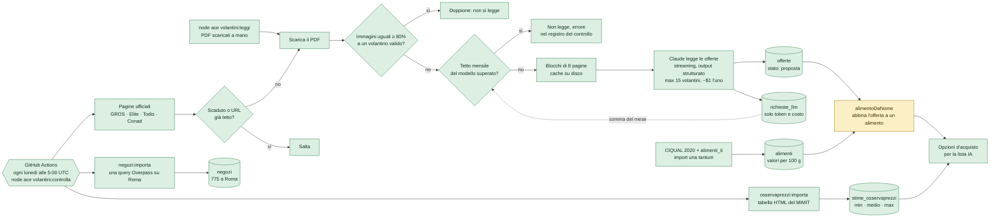
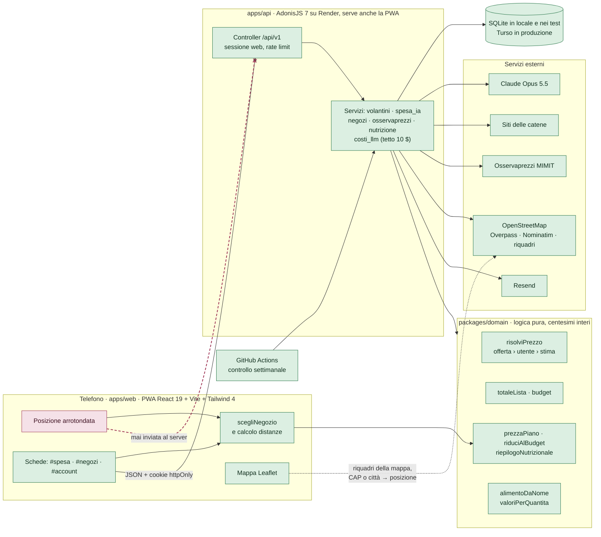

# Mappa del progetto

Stato al 17 novembre 2026, ricavato da `docs/decisioni.md` (D1–D20), `CLAUDE.md`, `.omc/plans/riordino-obiettivo.md` e dal codice.
Legenda dei colori: verde = fatto e verificato, giallo = parziale o da rivedere, rosa tratteggiato = pianificato, non iniziato.

## 1. Flusso dell'utente

```mermaid
flowchart TD
  A(["Apri la PWA"]) --> B{"Hai un account?"}
  B -->|no| C["Registrazione<br/>verifica email con Resend"]
  B -->|sì| D["Accesso<br/>cookie httpOnly, 5 tentativi"]
  C --> D
  D --> E["Cerca supermercati vicini<br/>posizione del telefono, oppure CAP o città<br/>tradotti in posizione da Nominatim"]
  E --> F{"Posizione dentro<br/>l'archivio di Roma?"}
  F -->|sì| G["Ricerca locale sul catalogo<br/>GET /negozi, distanze calcolate dal telefono"]
  F -->|no| H["Nessun negozio:<br/>l'app conosce solo il comune di Roma (D19)"]
  G --> I["Salva 'I miei negozi'"]
  I --> J["Imposta il budget del periodo<br/>settimana o mese"]
  J --> K["Preferenze: persone 1–12<br/>dieta mediterranea"]
  K --> L[["Bottone 'Prepara la lista'<br/>POST /liste/proposta, ~$0,05"]]
  L --> LIM{"Tetto mensile del modello<br/>superato? (D20)"}
  LIM -->|sì| LIMX["Messaggio chiaro,<br/>nessuna chiamata a Claude"]
  LIM -->|no| M["Opzioni d'acquisto<br/>offerte dei miei negozi + medie Osservaprezzi"]
  M --> N["Claude sceglie alimenti,<br/>grammi e priorità 1-2-3"]
  N --> O["Dominio: prezzaPiano<br/>confezioni intere o a peso"]
  O --> P{"Totale entro<br/>il budget residuo?"}
  P -->|no| Q["riduciAlBudget<br/>toglie priorità 3, poi 2"]
  Q --> R{"Ancora oltre?<br/>restano solo essenziali"}
  R -->|sì| S["Sforamento dichiarato<br/>all'utente"]
  R -->|no| T
  S --> T
  P -->|sì| T["riepilogoNutrizionale<br/>kcal e nutrienti a persona al giorno"]
  T --> U["Telefono: scegliNegozio<br/>budget rigido → totale + km × 1,50 €"]
  U --> V["Salva la lista<br/>POST /liste/da-proposta"]
  V --> W["In negozio: spunta le voci<br/>e inserisci il prezzo visto<br/>solo online"]
  W --> X[("prezzi_utente<br/>fonte manuale")]
  X --> DL["Dettaglio lista: risolviPrezzo<br/>offerta › prezzo utente › stima"]
  X -.->|"la lista IA ancora lo ignora<br/>(fase 3 del riordino)"| M
  W -.-> OFF["Lista offline<br/>(fase 4)"]
  W -.-> Y["Lista conclusa → prezzi pagati<br/>salvati in automatico"]
  V -.-> Z["Ricette dagli ingredienti comprati<br/>(fase 5)"]
  Z -.-> ZZ["Ingredienti mancanti<br/>con il loro costo"]

  classDef ok fill:#dcefe2,stroke:#2f7a4f,color:#12301f
  classDef part fill:#fbefc6,stroke:#9a7400,color:#3a2c00
  classDef todo fill:#f5e1e8,stroke:#a23b5a,color:#3d1020,stroke-dasharray:5 4
  class A,B,C,D,E,F,G,H,I,J,K,L,LIM,LIMX,N,O,P,Q,R,S,T,U,V,X,DL ok
  class M,W part
  class OFF,Y,Z,ZZ todo
```

`M` è giallo perché le opzioni d'acquisto non usano i prezzi pagati e contano le offerte "con carta" anche senza carta (`opzioni.ts`); `W` perché la lista funziona solo con la rete.

## 2. Flusso dei dati

`MATCH` è giallo: riconosce il 62% delle offerte alimentari; la fase 3 prevede che il codice dell'alimento lo indichi Claude in lettura. NaturaSì, Coop e Penny sono stati abbandonati (D19).

## 3. Architettura e confine della privacy

## 4. Punti aperti

| Tema | Stato | Nota |
|---|---|---|
| Primo deploy su Render | da fare | Tutto pronto e provato in locale (D20); mancano account e segreti dell'utente. |
| Prezzi pagati e carte fedeltà nella lista IA | non iniziato | Fase 3 del riordino: `opzioni.ts` non usa `risolviPrezzo`, ignora i prezzi dell'utente e conta le offerte "con carta". |
| Lista offline e prezzo pagato alla spunta | non iniziato | Fase 4 del riordino. |
| Prezzi pagati salvati a lista conclusa | non iniziato | Nessun codice con `fonte = lista`; c'è solo l'inserimento manuale. |
| Ricette dagli ingredienti comprati | non iniziato | Fase 5 del riordino; nessuna migrazione né servizio. |
| Costo al km regolabile | fisso a 1,50 € | `CENTESIMI_PER_KM` in `propostaLista.ts`; D13 lo vuole regolabile, D18 lo rimanda. |
| Offerte non verificate | accettato | Marcate "da volantino"; un formato letto male falsa prezzo al kg e budget. |
| Diete diverse e intolleranze | rimandato | Solo mediterranea (D16); `preferenze_alimentari` in fase 3 dello schema (D5). |
| Scontrini | scartati | D16; la fase 4 dello schema resta sulla carta. |
